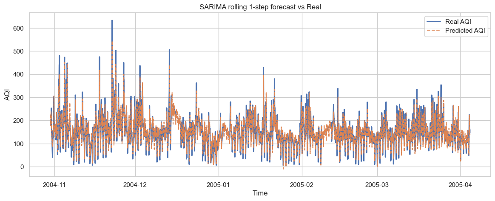
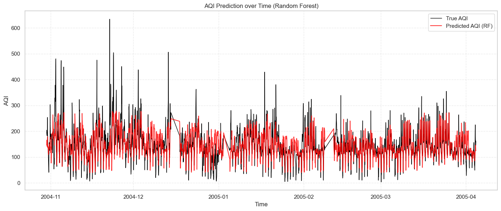
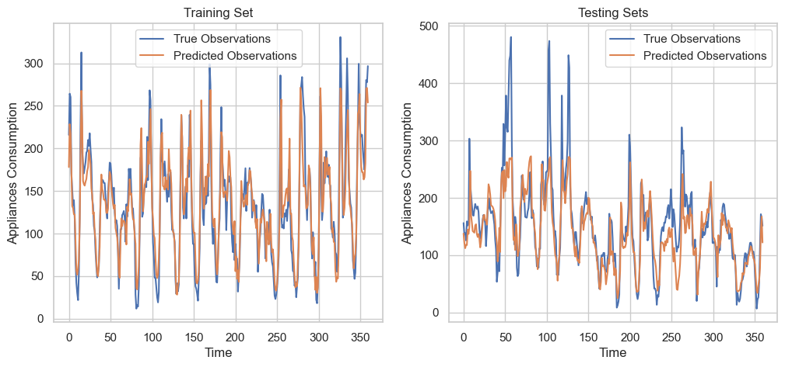
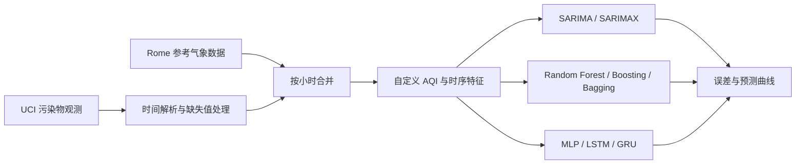

# 意大利空气质量预测：时间序列与机器学习模型比较

Air quality forecasting with UCI measurements and Rome reference weather data.

本项目使用意大利小时级污染物观测数据，结合罗马参考气象数据，研究空气质量序列的日周期、历史依赖与非线性变化，并比较 SARIMA、SARIMAX、随机森林、Gradient Boosting、Bagging、MLP、LSTM 和 GRU。项目包含数据清洗、自定义污染指数构建、时序特征工程、模型训练和预测可视化。

作者：Kaiwei HUANG、Fei WANG、Jiaxuan YU。原报告标注为 ISUP Master 2，2026 年 1 月。

## 模型预测效果

以下图像直接提取自 Notebook 已保存的输出，蓝色或黑色为真实值，橙色或红色为预测值。

### SARIMA：逐小时滚动预测



SARIMA (2,1,2)(2,1,2,24)，测试区间 RMSE 26.05、MAE 17.32。横轴为观测时间，纵轴为项目自定义 AQI；每预测一步后使用真实观测更新状态。

### 随机森林：测试区间预测



黑线为真实 AQI，红线为预测 AQI；最终保存拟合的 RMSE 为 46.23。该分支使用测试时间点的气象及历史滞后特征，输入条件与滚动 SARIMA 不同。

### GRU：24 步窗口补充实验



左图为训练集、右图为测试集的前 360 个样本，蓝线为真实值，橙线为预测值。整个测试集保存 MSE 为 1658.15、MAE 为 29.83。原图纵轴沿用了模板文字 `Appliances Consumption`，此处实际预测的是自定义 AQI；横轴为样本序号。各分支的评价条件见[结果说明](docs/RESULTS.md)。

图片来源、原始单元格和 SHA-256 记录在[图片清单](assets/figures/manifest.json)；运行 `python scripts/export_figures.py` 可重新提取原图，无需训练。

## 阅读入口

- [完整中法双语 Notebook](AirQuality中文版_.ipynb)：代码、方法解释和已保存的运行结果。
- [HTML 报告](AirQuality中文版_.html)：下载后用浏览器打开，无需安装 Python。
- [实验结果与比较口径](docs/RESULTS.md)：按预测方式分组阅读结果。
- [数据说明](docs/DATA.md)与[运行及复现说明](docs/REPRODUCIBILITY.md)。

## 项目做了什么

将污染物浓度转换为项目自定义的 AQI，按小时连接气象数据，再加入星期、意大利节假日、24 小时和 168 小时滞后特征。通过 ACF、PACF 和 STL 分解观察时间结构，分别用统计模型、树模型和神经网络建模。



这里的 AQI 是代码中按污染物分段映射后取最大值构造的研究指标。Rome 是气象参考地点；污染物数据的具体城市未在当前材料中确认。

## 已保存的实验结果

以下数值摘自仓库 Notebook 的输出，整理时未重新训练。RMSE 和 MAE 越低，预测误差越小；它们的单位对应项目自定义 AQI。详细的 MSE、R²、单元格位置和结果来源见[结果说明](docs/RESULTS.md)及[机器可读记录](results/saved_metrics.csv)。

| 实验设置 | 模型 | RMSE | MAE |
| --- | --- | ---: | ---: |
| 滚动一步预测，逐小时更新真实观测 | SARIMA (2,1,2)(0,1,0,24) | 33.30 | 21.95 |
| 滚动一步预测，逐小时更新真实观测 | SARIMA (2,1,2)(2,1,2,24) | 26.05 | 17.32 |
| 固定起点预测，输入测试期气象与历史滞后特征 | SARIMAX | 59.03 | 45.10 |
| 表格特征回归 | Random Forest，最后保存的拟合 | 46.23 | — |
| 表格特征回归 | Gradient Boosting | 48.37 | — |
| 表格特征回归 | Bagging | 47.99 | — |
| 神经网络，测试集同时用于训练监控 | MLP | 47.16* | 32.89 |
| 神经网络，测试集同时用于训练监控 | LSTM，1 时间步 | 47.54* | 33.91 |
| 神经网络，测试集同时用于训练监控 | GRU，1 时间步 | 46.46* | 31.84 |
| 补充实验，24 时间步及不同预处理 | GRU | 40.72* | 29.83 |

\* 神经网络的 RMSE 由保存的 MSE 开平方换算。破折号表示该单元格未报告该指标。

在两组滚动一步 SARIMA 实验中，增加季节项后的保存结果为 RMSE 26.05。树模型的保存误差集中在 RMSE 46–49；神经网络部分还探索了从 1 时间步改为 24 时间步窗口。各组在样本处理、输入信息和验证方式上存在差异，因此表格按设置展示，不作跨组统一排名。

## 快速使用

只阅读报告时，直接打开上方 Notebook，或下载 HTML 后在浏览器查看。检查数据文件及导出已保存指标只需要 Python 标准库：

```bash
git clone https://github.com/Fei789844/Air-quality.git
cd Air-quality
python scripts/inspect_project.py
```

该命令核对 CSV 的有效行数、日期范围、重复时间戳和 SHA-256，检查代码单元格语法，并重新生成 `results/evidence.json` 与 `results/saved_metrics.csv`。它不运行模型。

如需执行原 Notebook，可在 Python 3.11 环境尝试安装以下依赖，并从仓库根目录启动 Jupyter：

```bash
python -m venv .venv
source .venv/bin/activate
python -m pip install -r requirements.txt
jupyter lab
```

原训练环境没有依赖锁文件。这份依赖清单根据导入语句整理；完整重训尚未在新环境验证。执行前请阅读[复现说明](docs/REPRODUCIBILITY.md)。

## 仓库结构

保留原始文件名和根目录位置，方便原 Notebook 继续读取相对路径。

```text
Air-quality/
├── README.md
├── requirements.txt
├── AirQuality中文版_.ipynb     # 完整实验与保存输出
├── AirQuality中文版_.html      # 原始静态报告
├── AirQualityUCI.csv           # 污染物与温湿度观测
├── Rome_meteo.csv              # Rome 参考气象数据
├── merged_df.csv               # 原项目导出的中间数据
├── assets/figures/            # README 预测图与来源清单
├── docs/
│   ├── DATA.md
│   ├── RESULTS.md
│   └── REPRODUCIBILITY.md
├── results/
│   ├── evidence.json           # 数据指纹、指标来源与语法检查
│   └── saved_metrics.csv
└── scripts/
    ├── inspect_project.py
    └── export_figures.py
```

## 数据来源与引用

污染物观测来自 [UCI Air Quality](https://archive.ics.uci.edu/dataset/360/air+quality)，气象数据来源在原报告中注明为 [Open-Meteo](https://open-meteo.com/en/docs/historical-weather-api)。本地文件的日期范围、字段、时区及数据使用说明见[数据文档](docs/DATA.md)。

UCI 推荐引用：De Vito, S. (2016). *Air Quality* [Dataset]. UCI Machine Learning Repository. https://doi.org/10.24432/C59K5F

如引用本项目，请注明上述三位作者，并链接本仓库及所使用的 commit。代码尚未单独声明开源许可证；第三方数据的使用条件以其来源页面为准。
